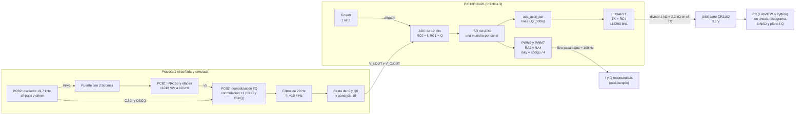

# Especificaciones para el preinforme (Micro 3: UART + ADC de I y Q)

Proyecto Micro 3 · Fecha: 2026-10-30, actualizado el 2026-11-05 (coherencia con el código: PWM, sin anti-aliasing) · Versión: borrador v3 · Estado del firmware: ADC y envío ASCII (T-09) y PWM de reconstrucción (T-06) **implementados y compilados con XC8 2.40**; la persona confirmó que el modo ASCII funciona (2026-11-04), sin medir todavía; el eco de la UART a 115200 está probado. **Sin filtro anti-aliasing** en esta entrega.

> **Para qué sirve:** es el documento que se lee **antes de escribir cualquier preinforme** de esta práctica. Reúne en un solo lugar lo que la clase pidió, los valores de diseño del PIC (UART y ADC), el detalle de cada bloque, los diagramas de tiempo, cómo se arma cada línea de texto, cómo se mide y qué cumple o no cumple. No reemplaza a los otros documentos: los resume y dice dónde está el detalle (§14).
>
> **Etiquetas:** **[VERIFICADO]** = sale del datasheet (con página), del código, de una prueba hecha o de un documento de `docs/`. **[CÁLCULO]** = cuenta propia comprobada con un script. **[PROPUESTA]** = decisión por aprobar. **[SIN VERIFICAR]** = duda que se resuelve midiendo o preguntando al profesor.
>
> **Fuentes:** notas del chat del equipo (captura del 2026-10-30), mensaje de la persona del 2026-10-30, `docs/` del proyecto, el preinforme de la Práctica 2 y el código recibido el 2026-10-30. Datasheet del PIC: DS40001985C («DS»).

---

## 0. Cómo usar este documento

1. Léelo entero. Después lee `docs/estado.md` (qué está probado y qué no) y, solo si hace falta más detalle, los archivos de §14.
2. Un preinforme es de **diseño y cálculo**. Lo que no se midió se escribe como «calculado» o «previsto», nunca como resultado. Hoy **no hay ninguna medición del ADC** (§12).
3. Cada número del preinforme debe salir de una tabla de este archivo o de los documentos de §14. Si falta uno, se calcula con un script y se marca [CÁLCULO].
4. Respeta las etiquetas. Lo [SIN VERIFICAR] se escribe como supuesto o pendiente, no como hecho.
5. Formato y estilo: el del preinforme de la Práctica 2 (§13). Mismo cuidado con «calculado, no medido».
6. Si algo de aquí contradice a lo que pida el profesor, manda el profesor; después `docs/criterios_diseno.md` y `docs/especificacion_diseno_uart.md`, y al final este archivo. Se avisa a la persona (§11).
7. Si la persona cambia un valor (baud, formato de las líneas, `fs`, referencia), se actualiza primero el documento de decisión y luego este.

---

## 1. Qué pidió la clase

Notas del chat del equipo (captura del 2026-10-30) y mensaje de la persona. La palabra **OBLIGATORIOS** está en el chat, justo después de «que nuestro diseño de hardware cumpla las especificaciones».

| ID | Qué se pidió (casi textual) | Qué significa para el diseño | Dónde |
|---|---|---|---|
| RC-1 | «Documento de especificaciones con valores de UART y ADC en base al micro» | Valores sacados del PIC16F18426, no genéricos | §2, §3, §5 |
| RC-2 | «Diagramas de tiempo, tiempo de conversión, lectura de ADC, conversión a decimal y a ASCII, o el armado de la trama» | Mostrar cuánto tarda cada paso, de la muestra al byte en la línea (aquí: conversión a decimal y a ASCII) | §6, §7 |
| RC-3 | «Que nuestro diseño de hardware cumpla las especificaciones. **OBLIGATORIOS**» | Tabla de cumplimiento requisito por requisito | §9 |
| RC-4 | «Resistencia de manejo de entrada del *sampling and hold* y tener en cuenta la resistencia de salida del operacional que estamos usando» | `RS` en el tiempo de adquisición; `Zout` del opa de PCB2 | §5 (B3), §9 |
| RC-5 | «El profe recomienda que, independiente de la fuente, tengamos esa fuente física en un pin; próxima clase y el programa hecho» | Hito: señal real en RC0/RC1 y programa funcionando | §10 |
| RC-6 | «Desviación estándar del histograma del periodo» y, según la persona, **jitter con σ < 10 ns** | Medir el periodo de muestreo 10 000 veces | §8.2 |
| RC-7 | «10 mil muestras con LabVIEW para hacer el histograma» | Captura de 10 000 muestras y su histograma | §8.1 |
| RC-8 | «Modular los resultados del ADC y ver los 10 Hz» | Ver un tono de 10 Hz en los datos del ADC | §8.4 [SIN VERIFICAR] |
| RC-9 | «Precisión del auto-cero: cuánta necesitamos» | **Pasa a Macro** (cambio de enfoque del profesor, 2026-11-04). En Micro 3: un PWM por canal reproduce las muestras y un filtro pasa bajos devuelve la señal analógica | §5 (B7), §8.5 |
| RC-10 | Persona: «con 12 bits debo tener 72 dB de SINAD en condiciones ideales»; `fs` = 1 kHz | Referencia ideal del ADC y frecuencia de muestreo | §3, §8.3 |
| RC-11 | Persona: qué se hace en transmisión y en el PC; formato lógico y físico; baud; velocidad; cuántos bytes; qué formato | Respuestas directas | §2 |

Requisitos técnicos ya vigentes del ADC (detalle en `docs/especificacion_adc.md` §1):

| ID | Requisito | Valor | Origen |
|---|---|---|---|
| R1 | Frecuencia de muestreo | `fs` = 1 kHz | profesor |
| R2 | I y Q convertidos | dentro de 1 ms | derivado de R1 |
| R3 | Resolución | 12 bits | datasheet (`AD01`, DS p.632) [VERIFICADO] |
| R5 | SINAD del ADC | **> 60 dB** (ENOB > 9,67 bits) | persona, 2026-10-30 |
| R7 | Jitter | importa el del instante de muestreo, no el del reloj de conversión | profesor |
| R8 | Ruido | histograma y conteo de códigos | profesor |
| R10 | Referencia | justificar `Vref` y su ruido | profesor |

---

## 2. Respuestas directas a las preguntas de transmisión y PC

| Pregunta | Respuesta | Etiqueta | Detalle |
|---|---|---|---|
| ¿Qué hace el PIC? | Muestrea I (RC0) y Q (RC1) cada 1 ms con el ADC (sin promedio), copia cada par a PWM6 (RA2) y PWM7 (RA4) y, cada 2 pares, manda una línea de texto `xxxx,xxxx\r\n` por la UART: 500 líneas/s. Empieza al encender; no recibe comandos | [VERIFICADO en el código] | §5 B5 a B9 |
| ¿Qué hace el PC? | Abre el puerto a 115200 8N1, lee línea por línea (hasta `\n`), separa I y Q con `%d,%d`, descarta las líneas con otra forma, convierte los códigos a voltios y dibuja (plano I–Q, histograma, espectro) | [VERIFICADO] (`herramientas/interfaz_micro3.py`); el VI de LabVIEW, guía en `docs/guia_labview_paso_a_paso.md` | §5 B10, §8 |
| Formato lógico | Texto **ASCII**: `2048,2051\r\n`, números en decimal de 0 a 4095, hasta 11 bytes por línea | [VERIFICADO] | §7, `especificacion_protocolo.md` |
| Formato físico | UART asíncrona **8N1** (8 datos, sin paridad, 1 parada), primero el bit menos significativo, TTL. PIC a 3,7 V; el TX baja a ≈ 2,54 V por un divisor de 1 kΩ + 2,2 kΩ para el módulo USB-serie de 3,3 V (CP2102); el RX del PIC es de nivel TTL. Tierra común | [VERIFICADO] / [CÁLCULO] (2,54 V) | §5 B8 |
| Baud rate | **115200** pedido; el chip genera **114 286** (`SP1BRG` = 34), error **−0,79 %** | [CÁLCULO] | §5 B8 |
| Velocidad de transmisión | Capacidad de la línea: 11 429 B/s (a 114 286 baud). Uso: **5500 B/s** (500 líneas/s de 11 B) = **48,1 %**; queda el 51,9 % libre | [CÁLCULO] | §3 |
| ¿Cuántos bytes se transmiten? | Hasta 11 por línea; 8 son las cifras de I y Q y 3 son de formato (la coma y `\r\n`). En el histograma de 10 000 muestras: ≈ 110 000 B (20 s) | [CÁLCULO] | §7 |
| ¿Qué formato de transmisión? | ASCII, una línea por par, 500 líneas/s (`ADC_PARES_POR_LINEA` = 2). El ADC muestrea a 1 kHz; al PC llega 1 de cada 2 pares | [VERIFICADO] | §7 |
| SINAD con 12 bits | Ideal **72 dB** (regla de 6,02 dB por bit = 72,2 dB); la fórmula completa con una senoidal a escala completa da **74,0 dB**. El **requisito** del proyecto es **> 60 dB** | [CÁLCULO] | §8.3 |

> El enunciado de la práctica sugiere líneas ASCII a 9600 o 19200 baud. Nosotros usamos ASCII a 115200 (decisión de la persona, 2026-11-04): a 9600 baud solo cabrían 87 líneas/s. La justificación y lo que se pierde frente a una trama binaria están en `docs/criterios_diseno.md` §5.

---

## 3. Tabla maestra de valores de diseño

### 3.1 Reloj y tiempo

| Parámetro | Valor | Etiqueta | Fuente |
|---|---|---|---|
| Oscilador | HFINTOSC 16 MHz, sin PLL ni cristal; exactitud nominal ±2 % | [VERIFICADO] | `especificacion_diseno_uart.md` §2 |
| Ciclo de instrucción `TCY` | 250 ns | [CÁLCULO] | Fosc/4 |
| Timer0 | 8 bits, reloj Fosc/4, prescaler 1:16, `TMR0H` = 249 → 250 cuentas × 4 µs = **1000 µs** | [CÁLCULO] | `tmr0.c`; DS p.261, p.267 |
| Disparo del ADC | `ADACT = 0x02` = `TMR0_overflow` (Tabla 32-6, DS p.538); en modo de 8 bits es la **coincidencia** `TMR0L = TMR0H` | [VERIFICADO] | `especificacion_adc.md` §2.1 |
| `fs` | **1 kHz por canal** (cada disparo convierte I y Q: 1000 pares/s, sin promedio). El PWM se actualiza con cada par (1000/s); al PC llega 1 de cada 2 (**500 líneas/s**, fs = 500 Hz en el PC) | [VERIFICADO] | `adc_iq.c`, `main.c`, `adc_ascii.h` |
| Filtro anti-aliasing | **ninguno** en esta entrega (Nyquist: 500 Hz en el ADC, 250 Hz en el PC) | indicación de la persona (2026-11-05) | – |
| Sobremuestreo respecto de 20 Hz | `fs/(2·20 Hz)` = 25 | [CÁLCULO] | |

### 3.2 ADC

| Parámetro | Valor | Etiqueta | Fuente |
|---|---|---|---|
| Resolución | 12 bits; 4096 códigos | [VERIFICADO] | DS `AD01` |
| Referencia | `VREF+ = VDD = 3,7 V`, `VREF− = VSS` (`ADREF = 0x00`) | [VERIFICADO] (falta confirmar con el profesor) | `adcc.c` |
| LSB | 3,7 V / 4096 = **0,903 mV** | [CÁLCULO] | |
| Ruido de cuantización `σq = q/√12` | **261 µV** (el profesor citó 352 µV, que es de 5 V) | [CÁLCULO] | `especificacion_adc.md` §5 |
| Reloj del ADC | `ADCLK = 0x0F` → Fosc/32 → `TAD` = **2 µs** | [VERIFICADO] | `adcc.c` |
| Conversión | `14·TAD + 2·TCY` = **28,5 µs** | [CÁLCULO] | DS `AD22`, p.633 |
| Adquisición `ADACQ = 160` | **10 µs**, **40 µs** o **320 µs** según la unidad real; se mide (prueba 4.16) | [SIN VERIFICAR] | `especificacion_adc.md` §3 |
| Tiempo por canal | 38,5 µs (A), 68,5 µs (40 µs) o 348,5 µs (B) | [CÁLCULO] | |
| I + Q | **77 µs** (A), 137 µs o **697 µs** (B): menos de 1 ms en los tres casos | [CÁLCULO] | |
| Canales | I = RC0 (`ANC0`, pin 10); Q = RC1 (`ANC1`, pin 9); un solo ADC multiplexado | [VERIFICADO] | `adcc.h` |
| Entrada máxima permitida | `VDD + 0,3 V` | [VERIFICADO] | `especificacion_adc.md` §7 |
| INL / DNL | `AD02` ±1 LSb típ., ±2 máx.; `AD03` ±1 LSb (DS p.632, medidos a VDD = 3 V y `TAD` = 1 µs, no en nuestras condiciones) | [VERIFICADO] | |

### 3.3 Señal que llega al ADC (PCB2)

| Parámetro | Valor | Etiqueta | Fuente |
|---|---|---|---|
| Salidas | `V_I,OUT = Vref2 + 10·(I_LPF − I0)` y `V_Q,OUT = Vref2 + 10·(Q_LPF − Q0)` | [VERIFICADO] | preinforme P2, ec. 5 |
| `Vref2` | ≈ 1,85 V (tierra virtual, mitad de 3,7 V) | [VERIFICADO] | preinforme P2 §1.2 |
| Rango lineal de banda base | ±185 mV a la salida (ganancia 10) = 370 mV = **410 códigos** | [CÁLCULO] | preinforme P2 ec. 8 |
| LSB referido a la etapa de banda base | 0,903 mV / 10 = **90 µV** | [CÁLCULO] | |
| Filtro de cada canal | 2.º orden, R = 82 kΩ, C = 100 nF, `fn` ≈ 19,4 Hz, `Qf` ≈ 0,709 | [VERIFICADO] | preinforme P2 ec. 4 |
| Atenuación del filtro (Butterworth ideal, `fn` = 19,4 Hz) | −19,7 dB a 60 Hz; −28,5 dB a 100 Hz; −56,4 dB a 500 Hz; −107,8 dB a 9,6 kHz | [CÁLCULO] | |
| Cambio medido con una discontinuidad (P2, a 10 kHz, escala de LabVIEW) | 60 mV en I y 110 mV en Q (≈ 66 y 122 códigos) | [VERIFICADO] (valores del preinforme, no de las salidas físicas) | preinforme P2 tabla 5 |

### 3.4 UART, formato de envío y jitter

| Parámetro | Valor | Etiqueta | Fuente |
|---|---|---|---|
| Formato | 8N1, asíncrono | [VERIFICADO] | |
| Baud pedido / real | 115200 / 114 286 (error −0,79 %); `SP1BRGH` = 0, `SP1BRGL` = 34 (`BRGH` = 1, `BRG16` = 1) | [CÁLCULO] | `especificacion_diseno_uart.md` §2.2 |
| Tiempo de bit / byte | 8,68 µs / 86,8 µs (nominal 115200); 8,75 µs / 87,5 µs (real) | [CÁLCULO] | |
| Línea | hasta 11 bytes = 110 bits = **0,96 ms** con el baud real (0,96 ms a 115200) | [CÁLCULO] | |
| Capacidad | 11 429 B/s (≈ 1040 líneas de 11 B por segundo como máximo) | [CÁLCULO] | |
| Ocupación | 500 líneas/s: 5500 B/s, **48,1 %** | [CÁLCULO] | |
| Buffers | RX 32 B (hoy sin usar); TX 64 B (5 líneas) | [VERIFICADO] | `especificacion_diseno_uart.md` §7 |
| Memoria usada | XC8 2.40 (-O2, 2026-11-04): programa 1002 de 16 384 palabras (6,1 %), datos 204 de 2048 bytes (10 %) | [VERIFICADO] | `docs/estado.md` |
| **Jitter pedido** | **σ del periodo < 10 ns** | requisito de la persona | §8.2 |
| **SINAD ideal 12 bits** | 72 dB (6,02·N) / 74,0 dB (6,02·N + 1,76) | [CÁLCULO] | |
| **SINAD requisito** | **> 60 dB** | requisito de la persona | |

---

## 4. Arquitectura general



*(Diagrama en Mermaid: lo dibuja GitHub y el visor de VS Code con extensión. Para el preinforme se redibuja como figura.)*

Flujo de una muestra, en una línea: `señal de PCB2 → pin RC0/RC1 → S&H → ADC (SAR, 12 bits) → ADRES → ISR (guarda I y Q) → main: pwm_desde_adc (PWM6/PWM7 → filtro → señal) y adc_ascii_par (texto) → cola de TX → UART → divisor → CP2102 → PC`.

---

## 5. Detalle por bloque

Cada bloque dice qué hace, sus parámetros, su estado y dónde está el detalle. Estado: **diseñado** (solo papel), **implementado, sin probar** (código escrito) o **probado** (hay resultado de la persona).

### B1. Sensor y PCB1 (contexto: Práctica 2)

- **Hace:** compara una bobina activa con una de referencia en un puente y amplifica el desbalance. `Vd = V(IN_POS) − V(IN_NEG)`; salida `Vo(t) = Vref + Ao·cos(ω0·t + φo)`.
- **Valores:** `RBA` = 100 Ω, `RBR` = trimmer de 500 Ω; INA155 y etapas ≈ 1018 V/V a 10 kHz, corte global ≈ 20,1 kHz; límite de entrada ≈ 2,5 mV pico a pico para ≈ 2,55 V pico a pico en `Vo` (con 3,4 mV ya casi toca los rieles). Bobinas medidas: referencia 196,66 µH y 8,59 Ω; móvil 195,66 µH y 8,09 Ω (a 10 kHz).
- **Estado:** diseñado, simulado en LTspice y trasladado a Altium; la validación física está pendiente (preinforme P2 §3.3).
- **Detalle:** preinforme de la Práctica 2, §1.1 y §2.1.

### B2. PCB2: demodulación I/Q, filtro, resta y ganancia

- **Hace:** genera la excitación y las referencias desde un solo oscilador (coherencia de fase), demodula con conmutación ±1, filtra a 20 Hz, resta la referencia sana (`I0`, `Q0`) y aplica ganancia 10.
- **Valores:** oscilador ≈ 9,70 kHz teórico (≈ 9,6 kHz simulado); excitación ≈ 1,94 V pico a pico; all-pass de ≈ −88° a 9,6 kHz (calculado, no medido); comparador LM2903B, conmutador TS5A23157, opa TS924/TS924A; filtros de §3.3; offsets de ejemplo `I0` = 1,9295 V y `Q0` = 1,7705 V (dependen del ensayo).
- **Opa de salida:** el preinforme usa TS924/TS924A. El documento del proyecto `CAMBIOS_OPAMPS_Y_AMPLITUDES_2026-10-16.md` (no está en `docs/`) estudia pasar a MCP604 o TLV9064. **El modelo final está sin decidir** y de él depende `Zout` (B3).
- **Estado:** diseñado y simulado; PCB en Altium.
- **Detalle:** preinforme P2 §1.2 a §1.5; `docs/especificacion_pwm.md` §1.

### B3. Interfaz analógica de entrada del ADC (RC-4)

- **Hace:** conecta la salida de PCB2 al capacitor de muestreo del ADC. Lo que importa es la **resistencia total que ve `CHOLD`**: `RS` (salida del opa y cualquier resistencia en serie) + `RIC` + `RSS`.
- **Modelo del S&H** (DS §32.3, p.506–507) [VERIFICADO]: `CHOLD` = 28 pF, `CPIN` ≈ 5 pF, `RIC` = 1 kΩ, `RSS` ≈ 7 kΩ a 5 V (a 3,7 V no se pudo leer la gráfica: se usa 10 kΩ, conservador). Fuente recomendada: `RS` ≤ 10 kΩ (`AD08`, p.632).
- **Fórmula del tiempo de adquisición** (DS Ec. 32-1) [VERIFICADO]:

```
TACQ = TAMP + TC + TCOFF
TC   = CHOLD · (RIC + RSS + RS) · ln(2^(n+1) − 1)      con n = 12  →  ln(8191) = 9,011
TCOFF = 0,05 µs/°C · (T − 25 °C)        TAMP = 2 µs
```

- **Resultados** con `RSS` = 10 kΩ [CÁLCULO] (reproduce el ejemplo del datasheet, 7,79 µs con `RSS` = 7 kΩ, `RS` = 10 kΩ y 50 °C):

| `RS` | `TACQ` a 25 °C | a 50 °C | a 85 °C | `ADACQ` mínimo con `TAD` = 2 µs (50 °C) |
|---|---|---|---|---|
| 200 Ω (supuesto, no es dato del opa) | 4,83 µs | 6,08 µs | 7,83 µs | 4 |
| 1 kΩ | 5,03 µs | 6,28 µs | 8,03 µs | 4 |
| 5 kΩ | 6,04 µs | 7,29 µs | 9,04 µs | 4 |
| 10 kΩ | 7,30 µs | 8,55 µs | 10,30 µs | 5 |

- **Qué se sabe del opa:** el datasheet del MCP604 (`docs/MCP601-2.PDF`) **no da una impedancia de salida**; solo dice que la salida es una «fuente de baja impedancia». `RS` hay que obtenerlo simulando con su modelo SPICE o midiendo. Con ganancia de ruido 11 en la etapa final, el ancho de banda a lazo cerrado y el asentamiento a 9 `τ` serían: TS924A 364 kHz y 3,9 µs; MCP604 255 kHz y 5,6 µs; TLV9064 909 kHz y 1,6 µs [CÁLCULO, un solo polo; los `GBW` salen del documento de cambios de opa].
- **Cargas capacitivas:** el MCP604 recomienda una resistencia en serie `RISO` si la carga pasa de ≈ 40 pF (DS21314G §4.4, p.13); el pin del ADC ya presenta ≈ 33 pF. Esa `RISO` se suma a `RS`.
- **El capacitor de muestreo no se descarga entre conversiones** (DS p.507): al cambiar de I a Q conserva la carga del canal anterior, por eso `TACQ` no se recorta.
- **Estado:** diseñado; falta el dato de `Zout`.
- **Detalle:** `docs/especificacion_adc.md` §3.1 y §3.2.

### B4. Reloj y base de tiempo

- **Hace:** da el reloj del chip y el disparo exacto de cada muestra.
- **Valores:** HFINTOSC 16 MHz (`OSCFRQ`, `OSCCON1`); Timer0 de §3.1. En modo de 8 bits el hardware reinicia `TMR0L` solo cuando coincide con `TMR0H` (DS p.261); **no hay recarga por software ni interrupción de Timer0**, así que el periodo no depende del programa.
- **Dos dudas** [SIN VERIFICAR]: (1) con postscaler 1:1, `TMR0_out` *conmuta* en cada coincidencia (DS p.262) y el ADC arranca con un *flanco de subida* (DS p.504); el datasheet no dice si el `TMR0_overflow` de la Tabla 32-6 es el pulso de cada coincidencia (1000 µs) o la salida que conmuta (2000 µs). La prueba 4.5 lo decide; si sale 2000 µs, `TMR0H` = 124. (2) La exactitud nominal del oscilador (±2 %) es mayor que el criterio de ±1 % de la prueba 4.5; se puede ajustar con `OSCTUNE`.
- **Estado:** implementado, sin probar.
- **Detalle:** `docs/especificacion_adc.md` §2.1; `docs/notas_pic16f18426.md` §9.2.

### B5. ADC (ADCC) de 12 bits, multiplexado

- **Hace:** convierte un canal por vez. Un multiplexor analógico elige RC0 (I) o RC1 (Q) con `ADPCH`; el capacitor de muestreo se carga durante la adquisición y se desconecta de la entrada (típ. 100 ns) al empezar la conversión (DS Fig. 32-2, p.501), de modo que el **instante de muestreo es el final de la adquisición**.
- **Valores:** de §3.2. Resultado justificado a la derecha en `ADRESH:ADRESL` (12 bits). Modo básico, sin promedio por hardware.
- **Secuencia por tick:** Timer0 → I (hardware); la ISR guarda I, pone `ADPCH` = Q y `ADGO` = 1 → Q (software); la ISR guarda Q, vuelve `ADPCH` a I y deja el par listo (sin sumar).
- **Sesgo entre I y Q** (Q se muestrea `T_canal` después de I) [CÁLCULO]: error a 20 Hz de 0,48 % (0,28°) en el caso A, 0,86 % (0,49°) en el de 40 µs y 4,4 % (2,5°) en el B.
- **Estado:** implementado, sin probar.
- **Detalle:** `docs/especificacion_adc.md` §2, §3, §10.

### B6. ISR del ADC

- **Hace:** en cada fin de conversión (`ADIF` y `ADIE`) guarda el resultado y arranca la conversión siguiente. Al terminar Q deja el par listo para el programa principal (`adc_iq_get`), sin sumar ni dividir: una muestra por canal, 1000 pares/s en el PIC (sin promedio desde el 2026-11-03).
- **Valores:** `ADC_PIN_PRUEBA` = 2 saca la salida del Timer0 por RC2 (cada flanco = un disparo); con 1, RC2 sube durante cada ISR (dos pulsos por tick). Contadores `adcParesPerdidos` y `adcLineasPerdidas`, que deben quedar en 0.
- **Restricción:** una sola ISR para todo el chip (vector `0x0004`, sin prioridades ni anidamiento). La ISR del ADC espera si una de la UART está corriendo; la recepción tolera ≈ 174 µs de retraso antes de perder un byte (`especificacion_diseno_uart.md` §6).
- **Duración de la ISR:** sin medir (prueba 4.13).
- **Estado:** implementado, sin probar.

### B7. PWM por canal y filtro de reconstrucción (cambio de enfoque, 2026-11-04)

- **Hace:** cada par del ADC fija el duty de un PWM por canal (I → PWM6, Q → PWM7). Un filtro pasa bajos quita la frecuencia del PWM (15,625 kHz) y devuelve la señal analógica que entró por RC0/RC1. Es el filtro de reconstrucción; antes del ADC no hay filtro anti-aliasing. `V = VDD · duty`, con la misma `VDD` que el ADC: ganancia 1 sin calibrar.
- **Valores** [VERIFICADO / CÁLCULO, `docs/especificacion_pwm.md`]: PWM6 en RA2 (I) y PWM7 en RA4 (Q); Timer2 con `T2PR` = 255 a Fosc/4 → 64 µs = **15,625 kHz**; 10 bits = 1024 pasos de 3,61 mV; `duty = (código + 2) >> 2` (12 → 10 bits, máximo 1023); duty inicial 512; se actualiza 1000 veces por segundo (un par cada 1 ms).
- **Filtro** [PROPUESTA, `docs/especificacion_pwm.md` §6]: Sallen-Key de ganancia 1 con R1 = R2 = 22 kΩ, 100 nF y 47 nF (f0 ≈ 105 Hz, Q ≈ 0,73): −0,01 dB a 20 Hz, −39 dB a 1 kHz, −87 dB a 15,6 kHz, rizado ≈ 0,2 mV pp. Alternativa pasiva: 2 × (10 kΩ + 100 nF), −0,46 dB a 20 Hz y rizado ≈ 0,5 mV pp.
- **Calidad esperada** [SIMULACIÓN]: SINAD de la salida reconstruida ≈ 54 dB a 20 Hz y ≈ 64 dB a 5 Hz (límite: el 2.º armónico del PWM de flanco final). **No es** el requisito de > 60 dB, que es del ADC (prueba 4.15).
- **Estado:** código implementado (T-06, `pwm.c/.h`) y compilado con XC8 2.40; sin probar en el chip; filtro sin montar.
- **Macro:** el auto-cero con PWM (sustituir los trimmers `I0`/`Q0`, residuo ±20 códigos con 10 bits, filtro de 30 Hz) queda documentado en `docs/macro_autocero_pwm.md`.

### B8. UART y capa física

- **Hace:** saca los bytes del PIC al PC sin bloquear el programa.
- **Valores:** EUSART1; TX = RC4 (pin 6, por PPS `0x0F`), RX = RC5 (pin 5; TTL con `INLVLC5` = 0 era lo decidido, pero **el código actual lo deja en Schmitt** (`INLVLC = 0x3F` en `pin_manager.c`; VIH = 2,96 V)); FIFO de RX de 32 B y de TX de 64 B; una ISR con dos bloques (RX y TX; hoy el RX no se lee); `tx_DAT(data, size)` (todo o nada) y `tx_string(s)` devuelven `true` o `false` sin esperar.
- **Niveles** [VERIFICADO + CÁLCULO]: el TX del PIC sale a ≈ 3,7 V; el divisor 1 kΩ + 2,2 kΩ lo deja en 3,7 · 2,2/3,2 = **2,54 V**, sobre el mínimo de 1,9 V del CP2102 con VIO = 3,3 V. El RX tiene entrada TTL: exige `VIH` ≥ 1,73 V (con Schmitt serían 2,96 V). Nunca un conversor a 5 V.
- **Estado:** eco probado el **2026-10-19** a 115200 8N1 con `prueba_uart.py` (1.5: 20/20; 1.6: 256/256; 1.7: 1000/1000 en 141 ms; saludo `Micro3 listo`; 5 corridas seguidas sin fallas) [VERIFICADO: `docs/resultados_pruebas_uart.md`]. Faltan la capa física con osciloscopio (1.1 a 1.4) y las pruebas 1.9 a 1.16.
- **Detalle:** `docs/especificacion_diseno_uart.md` §2 a §7; `docs/circuito_uart.svg`.

### B9. Envío en texto ASCII

- **Hace:** `main` lee el par con `adc_iq_get()` y se lo pasa a `adc_ascii_par(i, q)`, que, cada `ADC_PARES_POR_LINEA` = 2 pares, escribe `xxxx,xxxx\r\n` con `a_decimal()` (restas sucesivas de 1000, 100, 10 y 1: sin `printf` ni división) y lo encola con `tx_string()`. Todo en el programa principal, nunca en la ISR.
- **Valores:** 500 líneas/s, hasta 11 B por línea, 0,96 ms en la línea cada 2 ms (48,1 %). Si la línea no cabe en el buffer de TX se descarta y se cuenta en `adcLineasPerdidas`.
- **Sin comandos:** el envío empieza al encender; el PIC no lee el RX.
- **Estado:** la persona confirmó el 2026-11-04 que el modo ASCII funciona; falta medir con 500 líneas/s (pruebas 2.1 a 2.6).
- **Detalle:** `docs/especificacion_protocolo.md`.

### B10. Software del PC (LabVIEW o Python)

1. Configurar el puerto: 115200, 8 bits de datos, sin paridad, 1 bit de parada, sin control de flujo, **carácter de fin `\n`** habilitado.
2. Leer una línea en cada vuelta (*VISA Read*).
3. Separar con `%d,%d` (*Scan From String*); si falla, descartar la línea y contarla como mala.
4. Convertir: `V = código · 3,7 / 4096`; banda base = `(V − Vref2) / 10`.
5. Mostrar: plano I–Q (eje X = I, eje Y = Q), histograma, espectro y el contador de líneas malas; guardar en CSV (tiempo = n / 500 s).
6. Diagnóstico «tubo sano / dañado» del enunciado: fuera del alcance de este documento.

- **Herramientas:** `herramientas/interfaz_micro3.py` (SINAD, ENOB, ruido, histograma; `docs/interfaz_mediciones.md`) y la guía del VI en `docs/guia_labview_paso_a_paso.md`.
- **Límite:** el PC **no puede medir el jitter de 10 ns** con la hora de llegada de las líneas: pasan por USB-serie, con latencias de milisegundos (§8.2).
- **Estado:** la interfaz de Python funciona con el simulador; el VI de LabVIEW está por armar con la guía.

### B11. Programa principal

- **Hace:** `while(1) { if (adc_iq_get(&i, &q)) { pwm_desde_adc(i, q); adc_ascii_par(i, q); } }`, sin esperas bloqueantes (prohibido `while(!TXIF)` y `__delay_ms`). Un solo modo: no hay constantes de modo que cambiar.
- **Estado:** implementado; el modo ASCII funciona según la persona (2026-11-04).

---

## 6. Diagramas de tiempo

### 6.1 Un tick de 1 ms: disparo, I y Q (caso A, `ADACQ` = 10 µs)

No está a escala; los tiempos exactos van en la tabla de abajo. La duración de la ISR es de unos microsegundos y **no se ha medido** (prueba 4.13).

```
[ adq. I ][ conversion I ][ISR][ adq. Q ][ conversion Q ][ISR]
|         |               |    |         |               |
|         |               |    |         |               +-- ADIF de Q: segunda ISR (hacia 77 us + 2 t_ISR)
|         |               |    |         +-- muestreo de Q: fin de la adquisicion
|         |               |    +-- ADGO = 1 lo pone el software: arranca Q
|         |               +-- ADIF de I: entra la ISR (38,5 us en el caso A)
|         +-- muestreo de I: fin de la adquisicion (10 us en el caso A)
+-- el hardware pone GO (Timer0 coincide, cada 1000 us)
```

| Instante (µs desde el disparo) | Evento | Caso A (10 µs) | Caso 40 µs | Caso B (320 µs) |
|---|---|---|---|---|
| 0 | Timer0 coincide; hardware pone `GO` | 0 | 0 | 0 |
| fin de la adquisición | se abre el S&H: **instante de muestreo de I** | 10 | 40 | 320 |
| fin de la conversión de I | `ADIF` = 1, entra la ISR (latencia 3 a 4 `TCY` = 0,75 a 1 µs, DS p.99) | 38,5 | 68,5 | 348,5 |
| tras la ISR | `ADGO` = 1 para Q | ≈ 38,5 + `t_ISR` | ≈ 68,5 + `t_ISR` | ≈ 348,5 + `t_ISR` |
| fin de la adquisición de Q | **instante de muestreo de Q** | ≈ 48,5 + `t_ISR` | ≈ 108,5 + `t_ISR` | ≈ 668,5 + `t_ISR` |
| fin de la conversión de Q | `ADIF` = 1, segunda ISR | ≈ 77 + 2·`t_ISR` | ≈ 137 + 2·`t_ISR` | ≈ 697 + 2·`t_ISR` |
| hasta el siguiente disparo | margen | ≈ 923 − 2·`t_ISR` | ≈ 863 − 2·`t_ISR` | ≈ 303 − 2·`t_ISR` |

[CÁLCULO] `t_ISR` es el tiempo de cada ISR del ADC, aún sin medir.

### 6.2 Dos ticks, una línea

```
tiempo (ms)         0         1         2         3         4
Timer0 (coincide)   ^         ^         ^         ^         ^
rafaga I y Q        IQ        IQ        IQ        IQ        IQ
main: linea          [ 0,96 ms   ]       [ 0,96 ms   ]
```

La ráfaga de I y Q termina hacia los 0,08 ms (caso A de §6.1). Cada 2 pares, `main` escribe la línea en texto (`a_decimal` y `tx_string`, ≈ 0,28 ms estimado, sin medir) y la encola: 11 bytes que tardan 0,96 ms. **Latencia desde la muestra hasta el último byte en la línea ≈ 1,3 ms** (0,1 + ≈ 0,28 + 0,96) [CÁLCULO], sin contar la latencia del USB-serie (sin medir). A 500 líneas/s la línea queda libre el 51,9 % del tiempo: cada línea termina ≈ 1 ms antes de que se encole la siguiente.

### 6.3 Un byte en la línea (`'2'` = 0x32 = 0011 0010, primero el bit menos significativo)

```
-----|____|____|----|____|____|---------|____|____|----|--------------
 idle  S    D0   D1   D2   D3   D4   D5   D6   D7   P   idle
  1    0    0    1    0    0    1    1    0    0    1    1
```

Cada bit dura 8,68 µs a 115200 (8,75 µs con 114 286). Un byte = 10 bits = 87,5 µs. Una línea de 11 bytes seguidos = **0,96 ms**. La FIFO de recepción del chip es de 2 bytes (hoy no se usa: el PIC no recibe comandos).

### 6.4 Otros diagramas que deben salir en el preinforme

| Figura | Qué muestra | De dónde sale |
|---|---|---|
| F-1 | Diagrama de bloques (§4) | redibujar |
| F-2 | Ráfaga I y Q dentro de 1 ms (§6.1), a escala, con los tres casos de `ADACQ` | este documento + prueba 4.16 con RC2 |
| F-3 | Cadencia: una línea cada dos ticks (§6.2) | este documento |
| F-4 | Un byte y una línea en la UART (§6.3) | este documento |
| F-5 | De la muestra a la línea de texto (§7.1) | este documento |
| F-6 | Circuito de la UART con el divisor 1 kΩ + 2,2 kΩ | `docs/circuito_uart.svg` |
| F-7 | Modelo del S&H: `RS`, `RIC`, `RSS`, `CHOLD` | DS §32.3, p.506 |
| F-8 | Histograma de códigos y espectro de la prueba de SINAD | **por medir** (§8) |

---

## 7. De la muestra a la línea de texto (conversión a ASCII)

### 7.1 Camino de una muestra (el implementado)

| Paso | Qué pasa | Ejemplo con `I = 2048`, `Q = 2051` |
|---|---|---|
| 1 | El ADC deja 12 bits justificados a la derecha en `ADRESH:ADRESL` | `2048 = 0x0800`, `2051 = 0x0803` |
| 2 | La ISR guarda el par tal cual (sin promedio) | `I = 2048`, `Q = 2051` |
| 3 | `pwm_desde_adc` fija el duty de los dos PWM; `adc_ascii_par` cuenta pares y solo cada 2 sigue | — |
| 4 | `a_decimal` resta 1000, 100, 10 y 1 las veces que quepa y suma `'0'` (`0x30`) a cada cifra | `2051` → `'2' '0' '5' '1'` = `32 30 35 31` |
| 5 | Se arma la línea (I, coma, Q, fin de línea) y se encola con `tx_string` | `2048,2051\r\n` |

```
byte:  0   1   2   3   4   5   6   7   8   9   10
      '2' '0' '4' '8' ',' '2' '0' '5' '1' CR  LF
       32  30  34  38  2C  32  30  35  31  0D  0A
```

### 7.2 Conversión a voltios (en el PC)

`V = código · 3,7 / 4096` y banda base `= (V − 1,85) / 10`. Con el ejemplo: 2048 → 1,8500 V; 2051 → 1,8527 V, es decir 0,27 mV por encima de `Vref2`, y 0,27 mV / 10 = **27 µV** en la etapa de banda base (menos de un LSB de 90 µV referido allí).

### 7.3 Cuánto ocupa la línea

| Líneas por segundo | Bytes/s (11 B) | Ocupación a 114 286 baud | ¿Cabe? |
|---|---|---|---|
| 1000 (cada par) | 11 000 | 96 % | apenas, sin margen |
| **500 (cada 2 pares, lo escogido)** | **5500** | **48,1 %** | sí |
| 20 (cada 50 pares) | 300 | 2,6 % | sí, pero no sirve para SINAD |

El costo en ciclos de la conversión a decimal en el PIC **no se midió** [SIN VERIFICAR]; si hiciera falta, se mide con RC2 y el osciloscopio.

### 7.4 Por qué texto [decisión de la persona, 2026-11-04: `docs/criterios_diseno.md` §5]

Se lee en cualquier terminal y en el Serial Plotter, y en LabVIEW basta *VISA Read* + *Scan From String*; es lo que sugiere el enunciado. A cambio: fs = 500 Hz en el PC (y no 1000), sin suma de verificación ni número de secuencia (una línea perdida no se ve) y sin comandos del PC al PIC.

---

## 8. Mediciones y criterios

Ninguna está hecha. Procedimientos completos en `docs/protocolos_prueba.md` (Módulo 4) y `docs/especificacion_adc.md` §6 y §8.

### 8.1 Histograma con 10 000 muestras en LabVIEW (RC-7)

| Dato | Valor |
|---|---|
| Entradas | 0 V (pin a GND, ruido propio del ADC) y `Vref2` ≈ 1,85 V (código ≈ 2048, incluye referencia y fuente) |
| Captura | 10 000 líneas `I,Q` → ≈ 110 000 B |
| Duración | 20 s (500 líneas/s, 48,1 % de la línea; sin promedio) |
| Validez | si `adcLineasPerdidas` sube o el PC mide menos de 500 líneas/s, esa captura no vale |
| Incertidumbre de la σ medida | 1/√(2·(M − 1)) = **0,71 %** con 10 000 muestras (1,10 % con 4096) [CÁLCULO] |
| Resultados | σ (en códigos y en µV), códigos distintos, pico a pico ≈ 6 a 6,6 σ, resolución efectiva `log2(FSR/σ)` |
| Referencia | `σq` = 261 µV (0,29 LSB); criterio de la prueba 4.3: σ ≤ 1,4 LSB (CP-6) |

El histograma con la entrada en corto **no incluye** el ruido de la referencia; con la entrada en `Vref2` entra la mitad. Por eso se hacen los dos.

### 8.2 Jitter: desviación estándar del periodo < 10 ns (RC-6)

**Qué dice la teoría** [CÁLCULO]: `SNR_jitter = −20·log10(2π·f·σt)`.

| `σt` | a 5 Hz | a 20 Hz | a 100 Hz | a 1 kHz | a 9,6 kHz |
|---|---|---|---|---|---|
| **10 ns** | 130 dB | 118 dB | 104 dB | 84 dB | 64,4 dB |
| 100 ns | 110 dB | 98 dB | 84 dB | 64 dB | 44 dB |
| 1 µs | 90 dB | 78 dB | 64 dB | 44 dB | 24 dB |

- Con σ = 10 ns, el jitter **no limita** un SINAD de 72 dB hasta **≈ 4,0 kHz** (de 74 dB, hasta 3,2 kHz). Nosotros muestreamos banda base de ≲ 20 Hz (la portadora de 9,6 kHz la demodula PCB2), así que 10 ns sobra por más de 40 dB. Para gastar solo 72 dB a 20 Hz bastaría `σt` ≤ 2,0 µs. El requisito de 10 ns es **mucho más estricto** que lo que pide el SINAD de este diseño.
- La idea del profesor: importa el jitter del reloj que **define el instante de muestreo**, no el del reloj de conversión (`TAD`).

**Qué se puede esperar de este firmware** [CÁLCULO y razonamiento, sin medir]:

| Canal | Quién fija el instante | Qué se espera de σ |
|---|---|---|
| I | hardware: Timer0 → `GO`, adquisición contada por hardware | solo el oscilador y la sincronización con el reloj del ADC. **El datasheet no especifica el jitter del HFINTOSC** (solo el del PLL, que no se usa, ±0,25 %, p.629) ni cuántos ciclos pasan entre el flanco y el inicio de la adquisición. **No se puede asegurar < 10 ns sin medir** |
| Q | **software**: la ISR pone `ADGO` | la latencia de interrupción es de 3 a 4 `TCY` (DS p.99): un rango de 250 ns; si fuera uniforme daría σ ≈ 72 ns, **7 veces el límite**. Y si una ISR de la UART está corriendo, la latencia sube a decenas de µs. **No se puede garantizar 10 ns**: el arranque es por software |

**Cómo medirlo** [PROPUESTA, hay que confirmar con el profesor qué instrumento y qué señal]:

- **LabVIEW no sirve para esto:** las líneas llegan por USB-serie con latencias de milisegundos. Sirve para el histograma de códigos (§8.1), no para el del periodo.
- **Osciloscopio o contador de tiempos** con estadística del periodo, 10 000 mediciones, resolución ≲ 1 ns (diez veces mejor que el criterio).
- **RC2 con `ADC_PIN_PRUEBA` = 1 no mide el reloj:** lo levanta la ISR, así que incluye el fin de la conversión y la latencia de interrupción. Podría mostrar hasta ≈ 72 ns de σ (latencia de 3 a 4 `TCY`) aunque el hardware fuera perfecto.
- **El disparo real ya sale por RC2:** con `ADC_PIN_PRUEBA` = 2 (lo que tiene el código) RC2 saca `TMR0_out` por PPS (`RC2PPS = 0x17`; DS p.262). Con postscaler 1:1 conmuta en cada coincidencia: se mide el tiempo entre flancos consecutivos (1000 µs cada uno). Falta confirmar el código PPS `0x17` en el datasheet (`notas` §5).
- Si el requisito debe cumplirse también para Q, hay que cambiar el diseño [PROPUESTA, decisión del planificador y de la persona]: un solo disparo por hardware a 2 kHz que alterne canales (I en ticks pares y Q en impares; cada canal queda a 1 kHz pero con 500 µs de sesgo entre I y Q, 6 % de error a 20 Hz), o encadenar un segundo evento por hardware (CLC o similar, sin estudiar).

### 8.3 SINAD (RC-10)

| Concepto | Valor |
|---|---|
| Ideal de 12 bits con senoidal a escala completa | 74,0 dB (6,02·12 + 1,76); la regla de 6 dB por bit da 72,2 dB |
| Requisito | **> 60 dB**, equivale a ENOB > 9,67 bits |
| Ruido + distorsión permitidos | 1,31 mV rms = 1,45 LSB rms a escala completa |
| Margen sobre el ideal | 14 dB |
| Con la señal real de PCB2 (±185 mV, el 10 % del rango) | un 12 bits ideal da 54 dB: **no alcanza 60 dB**. Se adoptó que el requisito es del ADC con una senoidal casi a escala completa [SIN VERIFICAR con el profesor] |

Procedimiento: generador directo a RC0 y luego RC1 (≤ 10 kΩ, sin PCB2), senoidal centrada en 1,85 V con 1,7 V de amplitud, **5 Hz y 20 Hz**, 4096 pares (8,2 s a 500 líneas/s), ventana de Kaiser y el script de `docs/especificacion_adc.md` §6 (prueba 4.15). Aceptación: SINAD ≥ 60 dB en las dos frecuencias y los dos canales. Con capturas sintéticas el script dio 73,5 dB sin ruido y 59,1 dB con 1,45 LSB rms.

### 8.4 «Modular los resultados del ADC y ver los 10 Hz» (RC-8) [SIN VERIFICAR]

No está claro qué significa «modular». Dos lecturas razonables:

1. **Entrada de 10 Hz:** inyectar una senoidal de 10 Hz (generador en RC0/RC1, o una portadora de ≈ 9,6 kHz modulada en amplitud a 10 Hz que PCB2 demodule), capturar ≥ 4096 pares y ver un pico en 10 Hz con la FFT. A 500 líneas/s el ancho de bin es 500/4096 = 0,122 Hz y el límite de Nyquist 250 Hz.
2. **Procesar en LabVIEW** los códigos del ADC (por ejemplo multiplicar por una referencia de 10 Hz) para ver ese componente.

Hay que preguntar cuál es. En el Serial Plotter, a 500 líneas/s, un tono de 10 Hz se ve pero corre rápido; con `ADC_PARES_POR_LINEA` = 50 (20 líneas/s) solo se ven bien señales de menos de 10 Hz.

### 8.5 PWM de reconstrucción (el auto-cero pasa a Macro)

Pruebas 3.1 a 3.8 de `docs/protocolos_prueba.md` (Módulo 3): frecuencia, duty que sigue a la entrada, continua y linealidad tras el filtro, rizado, seguimiento de una senoidal a 5 y 20 Hz, retardo e independencia de I y Q. Se comparan con §5 (B7).

---

## 9. Cumplimiento frente a las especificaciones (RC-3)

Estados: **Cumple (calculado)**: el cálculo lo cumple, falta medir. **Cumple (medido)**. **Por medir**. **No garantizado**: el diseño actual no lo asegura. **Falta dato**. **Sin hardware**.

| # | Requisito | Qué lo cumple y con qué valor | Estado | Prueba |
|---|---|---|---|---|
| 1 | `fs` = 1 kHz ± 1 % | Timer0 por hardware, 250 × 4 µs = 1000 µs. Dudas: 2000 µs si el ADC usa la salida que conmuta (§5 B4) y exactitud del oscilador ±2 % | Por medir | 4.5 |
| 2 | I y Q en < 1 ms | 77 µs (A), 137 µs (40 µs), 697 µs (B) | Cumple (calculado) | 4.16 |
| 3 | 12 bits | ADCC de 12 bits (`AD01`) | Cumple (datasheet) | 4.2 |
| 4 | `TACQ` suficiente | Con `ADACQ` = 10 µs y `RS` ≤ 10 kΩ a 50 °C se necesitan 8,55 µs: margen de 17 % (menos del 20 % deseado). Con `RS` ≤ 1 kΩ se necesitan 6,28 µs | Cumple (calculado), si `RS` ≤ 10 kΩ | 4.8 |
| 5 | Resistencia de salida del opa conocida | El datasheet del MCP604 no da `Zout`; falta simular (SPICE) o medir | **Falta dato** | 4.8 |
| 6 | Entrada del ADC ≤ `VDD + 0,3 V` | Salidas de PCB2 saturadas: 0,102 V y 3,598 V (simulación P2) < 3,7 V | Cumple (calculado) | – |
| 7 | Jitter σ < 10 ns, canal I | Disparo por hardware; el datasheet no da jitter del HFINTOSC ni la latencia de arranque | Por medir | §8.2 |
| 8 | Jitter σ < 10 ns, canal Q | Arranque por software: la latencia de interrupción varía 250 ns (σ ≈ 72 ns si es uniforme) | **No garantizado** | §8.2, 4.17 |
| 9 | SINAD > 60 dB (ideal 72/74 dB) | 12 bits ideales: 74 dB; quedan 14 dB para ruido, jitter, referencia y distorsión | Por medir | 4.15 |
| 10 | Referencia con poco ruido | `VDD` ratiométrica con `Vref2`; falta medir el ruido de `VDD` (criterio ≤ 26 µV rms) | Por medir | 4.3, §8.1 |
| 11 | Anti-aliasing: `fc ≤ fs/2` | **No hay filtro anti-aliasing en esta entrega** (indicación de la persona). El filtro de 19,4 Hz de PCB2 es de la demodulación (Práctica 2); con el generador directo al pin no hay ningún filtro | **Pendiente** | 4.7 |
| 12 | Enlace sin pérdidas | Eco a 115200: 20/20, 256/256, 1000/1000 | Cumple (medido, 2026-10-19) | 1.5 a 1.7 |
| 13 | Capacidad de la línea | 48,1 % a 500 líneas/s de 11 B; 51,9 % libre | Cumple, también el < 50 % de la prueba 6.6 (calculado) | 2.2, 4.14 |
| 14 | Error de baud | −0,79 %; peor caso combinado con el oscilador ≈ −2,8 % (al límite) | Cumple (medido en el eco) | 1.7, P2 |
| 15 | Niveles lógicos | TX a 2,54 V (≥ 1,9 V). RX: el código lo deja en **Schmitt** (`INLVLC = 0x3F`, `VIH` 2,96 V): con un CP2102 directo a 3,3 V el margen es de solo 0,34 V; con TTL serían 1,73 V | Revisar (TTL decidido, sin aplicar) | 1.1 a 1.4 |
| 16 | PWM que reproduce las muestras | 10 bits, paso 3,61 mV, ganancia 1 (misma `VDD` que el ADC) | Cumple (calculado); **sin probar** | 3.2 a 3.4 |
| 17 | Filtro de reconstrucción | Sallen-Key ≈ 105 Hz: −0,01 dB a 20 Hz, rizado ≈ 0,2 mV pp; SINAD simulado ≈ 54 dB a 20 Hz | Cumple (calculado); **sin hardware** | 3.5, 3.6 |
| 18 | Chip y alimentación | PIC16F18426 (no LF) con 2,3 a 5,5 V; PCB2 a 3,7 V | Por confirmar el marcado del chip | 0.1, 0.3 |
| 19 | Pines | Usados: RC4 (TX), RC5 (RX), RC0 (I), RC1 (Q), RA2 y RA4 (PWM), RC2 (salida del Timer0 para medir); sin tocar RA0, RA1, RA3 | Cumple | – |
| 20 | Sin esperas bloqueantes | ISR cortas, `tx_DAT` sin espera, bucle sin `__delay_ms` | Cumple (revisión de código) | 1.9, 1.13 |

---

## 10. Hitos y pendientes

### 10.1 Hito de la próxima clase (RC-5) [fecha por confirmar]

- [ ] Compilar en MPLAB X el proyecto `firmware/Micro_Firmware.X` (ya trae `nbproject/` con `adc_iq.c`, `adc_ascii.c`, `pwm.c`, `adcc.c` y `tmr0.c`; con XC8 2.40 ya compiló sin errores).
- [ ] Ver en el osciloscopio el PWM de RA2 y RA4 (15,625 kHz) y la salida del filtro de reconstrucción (pruebas 3.1 a 3.8).
- [ ] Conectar **una fuente física** a RC0 y RC1: generador (≤ 10 kΩ de impedancia) o salidas de PCB2.
- [ ] Ver las líneas en el Serial Plotter (prueba 4.18) y medir con `herramientas/interfaz_micro3.py` (pruebas 2.1 a 2.6, 4.3 y 4.15).
- [ ] Medir 4.5 (periodo), 4.16 (`ADACQ`) y 4.13 (duración de la ISR) con RC2.
- [ ] Anotar resultados en `docs/estado.md` y `docs/protocolos_prueba.md`. Nada se marca `probada` sin el resultado de la persona.

### 10.2 Pendientes que bloquean el preinforme

| # | Pendiente | Quién |
|---|---|---|
| 1 | Qué significa «modular los resultados y ver los 10 Hz» (§8.4) | profesor |
| 2 | Cómo y con qué instrumento se mide el jitter de 10 ns, y si aplica a Q (§8.2) | profesor y planificador |
| 3 | Qué calidad se pide a la señal reconstruida (amplitud, SINAD, retardo) y si el filtro puede ser pasivo (§5 B7) | profesor |
| 4 | SINAD > 60 dB: ¿del ADC con senoidal casi a escala completa o con la señal real de PCB2? (§8.3) | profesor |
| 5 | ¿Con qué ADC y `Vref` salen los 352 µV? | profesor |
| 6 | Unidad de `ADACQ` (10, 40 o 320 µs) | medición 4.16 |
| 7 | `TMR0_overflow`: ¿1000 o 2000 µs? | medición 4.5 |
| 8 | `Zout` del opa de PCB2 y modelo final (TS924A, MCP604 o TLV9064) | persona (SPICE o medición) |
| 9 | `Vref` del ADC: ¿`VDD`, FVR o externa? | profesor |
| 10 | ¿Se acepta el envío en texto ASCII a 115200 (500 líneas/s) en vez de 9600 o 19200? | profesor |
| 11 | Instrumento y qué se espera de «10 mil muestras con LabVIEW» (adquisición por UART o por DAQ) | profesor |

---

## 11. Contradicciones y riesgos detectados

1. **ASCII y baud:** el enunciado sugiere ASCII a 9600/19200; el proyecto usa ASCII a 115200 (a 9600 solo cabrían 87 líneas/s). El chat de clase admite «ASCII o el armado de la trama»: se documenta el camino ASCII (§7).
2. **Jitter de 10 ns frente a Q por software** (§8.2). Es el riesgo técnico más grande de esta lista.
3. **72 dB, 74 dB, 60 dB y 54 dB:** el ideal de 12 bits es 72 a 74 dB; el requisito es > 60 dB; con la señal real de PCB2 el ideal es 54 dB. No mezclar en el texto.
4. **352 µV frente a 261 µV:** el valor del profesor corresponde a 5 V; con 3,7 V son 261 µV.
6. **`ADACQ` = 160:** tres unidades posibles; los tiempos del preinforme deben presentarse como «caso A, caso B» hasta medir.
7. **Periodo del Timer0:** 1000 o 2000 µs (§5 B4). Todo el presupuesto de tiempo supone 1000 µs.
8. **Auto-cero:** pasa a Macro (cambio de enfoque del profesor, 2026-11-04). En Micro 3 el PWM reconstruye I y Q; su SINAD simulado (≈ 54 dB a 20 Hz) no se debe confundir con el requisito de > 60 dB del ADC.
9. **`ADC_PARES_POR_LINEA`:** con 50 (20 líneas/s) se ve mejor una señal lenta en el Serial Plotter, pero una medición hecha así no sirve para SINAD ni histograma. Para medir, 2.
10. **Datos de la Práctica 2 en escalas distintas:** las coordenadas de LabVIEW (60 y 110 mV) no son tensiones de las salidas físicas de PCB2; no compararlas con el rango del ADC sin calibrar (lo dice el mismo preinforme P2).
11. **Sin filtro anti-aliasing:** el enunciado (§3.2) pide `fc ≤ fs/2`; en esta entrega no hay filtro. Lo que llegue al pin por encima de 500 Hz se pliega en el ADC y por encima de 250 Hz en los datos del PC. Decirlo así en el preinforme (requisito 11 de §9, pendiente).

---

## 12. Qué se puede afirmar hoy y qué no

| Se puede afirmar (con su etiqueta) | No se puede afirmar |
|---|---|
| El enlace UART a 115200 8N1 devuelve 20/20, 256/256 y 1000/1000 bytes (medido el 2026-10-19, código de eco). El modo ASCII funciona (la persona, 2026-11-04) | Que llegan 500 líneas/s sin pérdidas durante 10 min (pruebas 2.2 y 2.4 sin hacer) |
| Los tiempos del ADC en los casos A, 40 µs y B, y que en los tres I y Q caben en 1 ms (calculado) | Cuál de los tres casos es el real; que `fs` sea 1 kHz (4.5 sin hacer) |
| `TACQ` mínimo según el datasheet para cada `RS` (calculado) | El `RS` real de PCB2 |
| El SINAD ideal de 12 bits y el presupuesto de 60 dB (calculado) | Ningún SINAD, ruido ni histograma medido del ADC |
| El jitter teórico a cada frecuencia y el límite de 4 kHz para 72 dB con 10 ns (calculado) | Que σ < 10 ns se cumpla (ni para I ni para Q) |
| La ocupación de la línea y la forma de cada línea (calculado) | La latencia real del USB-serie |
| La resolución del PWM de 10 bits y la respuesta del filtro de reconstrucción (calculado y simulado) | Que la señal reconstruida siga a la entrada (código sin probar, filtro sin montar) |

---

## 13. Estructura propuesta del preinforme

Se copia la del preinforme de la Práctica 2 (portada, resumen y palabras clave, secciones numeradas con ecuaciones, tablas y figuras, conclusiones, referencias en estilo APA y anexos). **Estilo a imitar:** cada resultado dice cómo se obtuvo («valor calculado, no medido»); «nota de precisión» cuando los decimales son resolución numérica y no exactitud; no se compara lo que está en escalas distintas.

| Sección | Contenido | De dónde sale |
|---|---|---|
| Portada y Resumen | Qué se diseñó (PIC como adquisición y comunicación de I y Q), valores clave (`fs` 1 kHz, 12 bits, 115200 8N1, líneas ASCII a 500 por segundo) y qué se verificó y qué no. Palabras clave: ADC, UART, corrientes de Eddy, microcontrolador | §2, §3, §12 |
| 1. Concepción y diseño funcional | 1.1 Requisitos. 1.2 Arquitectura en bloques. 1.3 Interfaz analógica y S&H (`RS`, `TACQ`). 1.4 Muestreo y temporización. 1.5 UART y formato de envío (ASCII). 1.6 PWM por canal y filtro de reconstrucción. 1.7 Software del PC | §1, §4, §5 |
| 2. Resultados y análisis | 2.1 Presupuesto de tiempo (diagramas). 2.2 Resolución, ruido y SINAD ideal. 2.3 Jitter. 2.4 Capacidad de la línea y formato. 2.5 Cumplimiento. 2.6 Plan de verificación (lo que se medirá) | §6, §7, §8, §9 |
| 3. Implementación | Pines, firmware (archivos, ISR, banderas), circuito de la UART, nivel lógico | §5 B4 a B11, `circuito_uart.svg` |
| 4. Conclusiones | Qué se cumple por cálculo, qué falta medir, riesgos (§11) | §9, §11, §12 |
| Referencias | Datasheet DS40001985C (Microchip, 2022); MCP601/1R/2/3/4 (DS21314G); *Fundamentals of Precision ADC Noise Analysis* (TI, SLYY192A, 2025); AN688 (`00688b.pdf`); TB3261; guía de XC8 (50002737C); preinforme de la Práctica 2. Completar autor, año y URL al citar | §14 |
| Anexos | A: esquemático de la UART. B: fragmentos de código comentados (`adc_iq.c`, `adc_ascii.c`). C: scripts de SINAD e histograma. D: tabla de verificación por pruebas (como la Tabla 6 de la P2) | `docs/`, `herramientas/` |

**Tablas obligatorias:** §3 (valores), §6.1 (tiempos), §9 (cumplimiento), §5 B3 (`TACQ` frente a `RS`), §5 B7 (PWM y filtro de reconstrucción). **Ecuaciones:** `TACQ`, `σq = q/√12`, SINAD y ENOB, `SNR_jitter`, baud rate, tiempo de una línea.

---

## 14. Documentos y fuentes

| Para qué | Archivo |
|---|---|
| Estado y lo que está probado | `docs/estado.md`, `docs/resultados_pruebas_uart.md` |
| Plan, reglas y tareas | `MASTER_PLAN.md` |
| Valores y motivos de las decisiones | `docs/criterios_diseno.md` |
| UART, pines, periféricos, eventos | `docs/especificacion_diseno_uart.md` |
| Formato de las líneas ASCII y cuentas | `docs/especificacion_protocolo.md` |
| ADC: tiempos, `TACQ`, jitter, SINAD, referencia, histograma | `docs/especificacion_adc.md` |
| PWM de reconstrucción (Micro 3) | `docs/especificacion_pwm.md` |
| Auto-cero con PWM (Macro) | `docs/macro_autocero_pwm.md` |
| Pruebas y criterios | `docs/protocolos_prueba.md` |
| Datos verificados del chip con páginas | `docs/notas_pic16f18426.md` |
| Revisión del código de MCC | `docs/revision_codigo_mcc.md` |
| Enunciado de la práctica | `docs/Especificacion_Tecnica_Practica3_Microcontroladores.md` |
| Opa MCP604 | `docs/MCP601-2.PDF` (`.gitignore` ignora `docs/*.pdf`; se sube con `git add -f`) |
| Práctica 2 (formato y datos de PCB1 y PCB2) | `Preinforme Practica 2 Final-...pdf` |
| Cambios de opa | `CAMBIOS_OPAMPS_Y_AMPLITUDES_2026-10-16.md` (proyecto de Claude, fuera de `docs/`) |
| Circuito de la UART | `docs/circuito_uart.svg` |

**Qué no verifiqué al escribir este documento:** el valor de `RSS` a 3,7 V; la duración de las ISR; el jitter del HFINTOSC; la latencia del USB-serie; el tiempo de la conversión a decimal en el PIC; el contenido de `CAMBIOS_OPAMPS_Y_AMPLITUDES_2026-10-16.md` (los `GBW` salen de mis notas anteriores); y el *Clean and Build* en MPLAB X (con XC8 2.40 desde la línea de comandos ya compiló, 2026-11-04).
